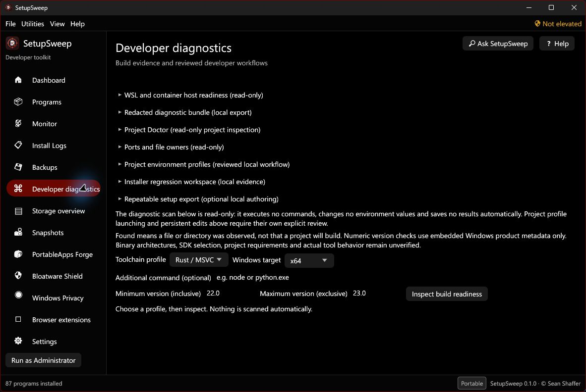
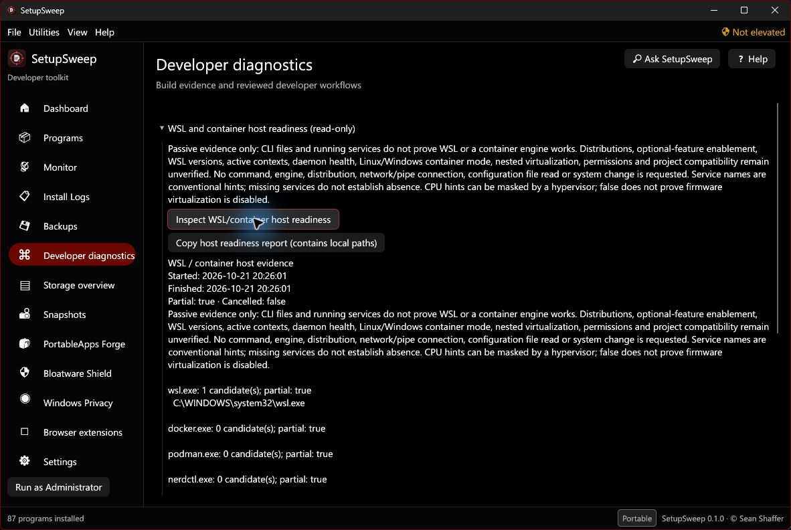
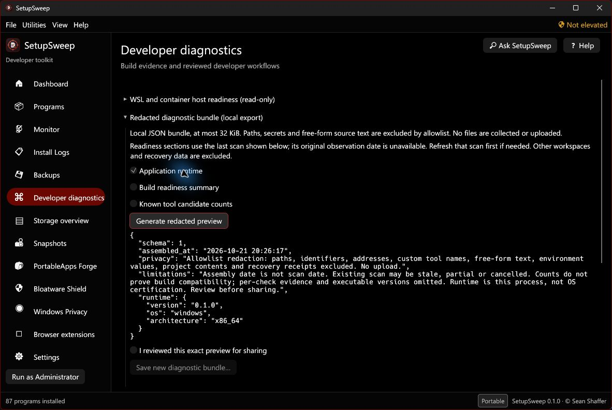

<p align="center">
  
</p>

<h1 align="center">SetupSweep</h1>
<p align="center"><b>A local-first Windows developer toolkit for understanding installs, inspecting development environments and reviewing system changes.</b></p>
<p align="center">
  <a href="LICENSE"></a>
  
  
  
</p>

**Development build, not a certified 1.0 release.** Development and verification currently happen locally. The latest developer milestones listed below are implemented in the local checkout; GitHub source and release assets may lag behind that checkout. This README update does not publish a new binary or synchronize those local source changes. Check the source and release notes for the version you actually build or download.

## What it does

- **Understand installations:** capture scoped before/after filesystem and registry evidence, then review installation logs and differences. Background activity and capture limits can affect attribution.
- **Manage programs and extensions:** inspect installed programs, use reviewed uninstall workflows and retain recovery evidence for supported changes.
- **Build portable/setup packages:** work from captured installation data within supported format and application limits. Not every application can be made portable.
- **Inspect developer environments:** surface local prerequisite, PATH, version and project-declaration evidence without silently running project code.
- **Keep control of changes:** explicit review for mutation, backups and recovery where supported. Recovery is not a guarantee that every vendor or system change can be undone.
- **Retain useful system controls:** debloat, Windows privacy and anti-telemetry workflows remain alongside storage inspection and snapshots.

General junk/browser cleanup, startup/task management, the context-menu editor, Slowdown Detective and the standalone System Restore manager are retired from the current local scope. Installation capture and recovery safeguards still use relevant internal Windows APIs. Existing saved data and legacy tasks are preserved.

## Developer milestones in the local checkout

| Tool | Current behavior and limits |
|---|---|
| Build readiness and PATH inspection | Local prerequisite files, candidate ordering/conflicts, PE/version metadata and numeric version checks. Presence does not prove a working build. |
| Project Doctor | Bounded manifest/version-declaration inspection and local toolchain evidence. Unsupported constraints remain unknown; project scripts do not run. |
| Installer regression workspace | Reviewed before/installed/upgraded/uninstalled captures and comparisons. Vendor installation/removal remains a separate user action. |
| Project environment profiles | Explicit developer path profiles, child-process environments and separately reviewed user-level changes with guarded undo. No inherited environment dump. |
| Ports and file owners | Read-only local TCP/optional UDP observations and selected-file Restart Manager evidence. No connections, process termination, unlocking or firewall edits. |
| Redacted diagnostic bundles | Selectable runtime/readiness/tool-count summaries, strict allowlist filtering, exact preview review and no-overwrite local JSON export. No automatic upload. |
| WSL/container host readiness | Passive CLI-file, Windows-service and processor-hint observations. No WSL/container command, distribution/engine start or daemon connection. Actual runtime health and compatibility remain unverified. |

The regular interface contains the working developer pages. The native Win32 interface is an experimental, partial migration; enabling it does not provide full workflow parity.

## Screenshots

Captured from the current local Windows x64 development build (0.1.0), using the regular interface without elevation. These are actual app captures, not mockups; they show local milestones that may be newer than hosted source or releases.

### Developer workspace



### Passive WSL/container observations



### Review before diagnostic export



## Build and test locally

Use Windows, Rust **1.91 or newer**, the MSVC C++ build tools and a Windows SDK. Target Windows 11 for local validation. ARM64 and broader Windows-version acceptance remain open; source compilation alone does not establish support.

```powershell
git clone https://github.com/SeanShaffer88/SetupSweep.git
cd SetupSweep
cargo build --locked
cargo run --locked
cargo test --locked
cargo clippy --all-targets --locked
cargo build --release --locked
```

If a locked-file test requires its fixture helper, build it first with `cargo build --example lockholder --locked`. In the current local checkout, `scripts/local.ps1` also wraps build, run, test, check and release steps.

The first build can download Rust dependencies. GitHub Actions and paid hosted builds are not required for local development. Existing releases, if available, are listed on the [Releases page](https://github.com/SeanShaffer88/SetupSweep/releases); verify the individual release's scope, architecture and checksums rather than assuming it includes the newest local tools.

## Privacy, data and safety

- Core diagnostic work runs locally; there is no automatic diagnostic upload or telemetry collection.
- Explicit clipboard/report exports can contain local paths. Redacted bundles deliberately exclude raw paths, environment values, credentials, project contents and sensitive recovery receipts.
- Installed-mode data normally lives under `%LOCALAPPDATA%\SetupSweep`; portable mode uses `SetupSweepData` beside the executable. Preserve that folder when replacing the program.
- Vendor installers, uninstallers, launch profiles and optional integrations can have their own effects. A read-only diagnostic result does not authorize a change or prove isolation.
- Review destructive plans and test vendor workflows in a disposable environment. Backups and restore-point safeguards do not replace a system backup.

## Verification and roadmap

Local tests, fixture probes and optimized builds are used to validate individual milestones. Live accessibility, DPI/high-contrast behavior, ARM64, broad vendor/format acceptance, recovery fault scenarios, signing and full native-interface parity remain release gates. No overall “100% complete” claim is made.

Next accepted work includes bounded build-log triage, workspace/Dev Drive guidance, dependency/provenance inventory and local release preflight. These are roadmap items, not current capabilities.

## License and contributions

Sean-owned SetupSweep code is licensed under the [MIT License](LICENSE). Bundled and third-party components retain their own licenses and notices. Please include a minimal reproduction and redact private paths, secrets and installation data when reporting an issue.
