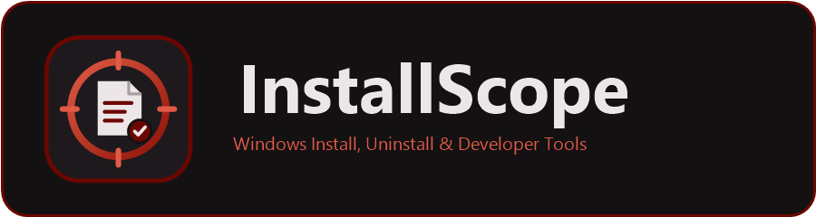

<p align="center">
  
</p>

<p align="center">
  <b>InstallScope</b> — a free, open-source (MIT) toolkit for Windows 11 that records exactly what an installation changes, removes it precisely, and builds portable packages from what it captured.<br>
  Written in Rust. Local-first: no telemetry, no accounts, nothing leaves your PC.
</p>

<p align="center">
  <a href="https://github.com/SeanShaffer88/InstallScope/releases/latest"></a>
  <a href="https://github.com/SeanShaffer88/InstallScope/actions/workflows/ci.yml"></a>
  <a href="LICENSE"></a>
  
</p>

<p align="center">
  <a href="#overview">Overview</a> •
  <a href="#download">Download</a> •
  <a href="#system-requirements">System requirements</a> •
  <a href="#getting-started">Getting started</a> •
  <a href="#features">Features</a> •
  <a href="#command-line">Command line</a> •
  <a href="#data-privacy-and-backup">Data, privacy and backup</a> •
  <a href="#safety">Safety</a> •
  <a href="#troubleshooting">Troubleshooting</a> •
  <a href="#building-from-source">Building from source</a> •
  <a href="#contributing">Contributing</a> •
  <a href="#license">License</a>
</p>

---

## Overview

InstallScope watches an installation, writes down everything it changed — files, folders, registry keys and values, services, scheduled tasks — and later turns that record into an itemized, reviewable removal plan. Every change InstallScope makes is backed up first, so almost anything it does can be undone.

| Stage | What happens |
|---|---|
| **Monitor** | InstallScope takes a snapshot of the system, runs the installer, snapshots again, and records every change as an install log. Sessions survive restarts, so installers that need a reboot are captured completely. |
| **Review** | Inspect every captured change, discard background noise with one click, and strip bundled bloat (judged as *Required*, *Optional* or *Bloatware* with reasons). Then save the log. |
| **Remove** | The log becomes a removal plan: added files, folders, registry keys and values are deleted; changed or removed values are **restored**; services are stopped and deleted; scheduled tasks are removed; only the `PATH` entries the installer added are taken out. You review and confirm the plan first. |
| **Recover** | Supported changes are backed up before they are applied. Restore them from the Backups page, or create a System Restore point as an additional safety net. |

Beyond uninstalling, InstallScope includes junk cleaning, a startup manager, system snapshots, a System Restore manager, portable-app packaging, and silent setup-package creation — all offline, all on your PC.

## Download

Download the latest version from the [Releases page](https://github.com/SeanShaffer88/InstallScope/releases/latest).

| File | Description |
|---|---|
| `InstallScope-Setup-x.y.z.exe` | Installer: installs to Program Files and adds a Start menu shortcut and an *Installed apps* entry. |
| `InstallScope-x.y.z-portable.zip` | Portable: unzip anywhere; all data is stored next to the executable. |
| `InstallScope-x.y.z-arm64-portable.zip` | Portable build for Windows 11 on Arm PCs. |

Every download is published with a SHA-256 checksum so you can verify it (in PowerShell: `Get-FileHash .\InstallScope-Setup-x.y.z.exe`). Downloads are not yet code-signed; see [Troubleshooting](#troubleshooting) for the SmartScreen warning.

## System requirements

- 64-bit Windows 11 (build 22000 or later), on x64 or Arm64. InstallScope is engineered for Windows 11 and will not start on earlier versions — it tells you and stops, instead of running with rules meant for Windows 11.
- Administrator rights are required for full functionality. InstallScope checks at every launch and offers a one-click relaunch as administrator; browsing programs, cleaning your own profile's junk, snapshots, and asking in plain language work without elevation.
- Windows Sandbox features (installer preview, isolated portable-app capture) need the *Windows Sandbox* feature, which is part of Windows 11 Pro, Enterprise, and Education.

## Getting started

1. Select **Monitor → Choose installer…** and pick a setup file (or right-click the installer in File Explorer and choose **Install with InstallScope**). Wait for the "before" snapshot to finish.
2. Install the program as usual. Optionally, run it once so its first-run settings are captured too.
3. Click **Finish monitoring**, review the changes — discard background noise, strike any bloat — and click **Save install log**.
4. When you want to remove the program, go to **Programs** (or **Install logs**) and click **Uninstall**. Review the plan, then confirm. If you change your mind, use **Backups → Restore**.

To try an installer safely first: on Pro/Enterprise/Education, choose **Test in Windows Sandbox first** on the Monitor page to see everything the installer would change in a throwaway copy of Windows, without touching your PC. On other editions, **Try it, then undo** installs under monitoring after making a restore point, shows the full review, then removes everything again — or keeps it with a complete install log.

To make a portable app instead, open **Portable packaging**, choose the installer, fill in the program's details, and click **Start**.

For installer quality checks in a build pipeline:

```
installscope monitor --name MyApp --no-prompt --json -- dist\MyApp-Setup.exe /S
installscope revert <log-id> --keep-log
installscope check-clean <log-id>            # exits with code 2 if anything was left behind
```

## Features

InstallScope is organized into pages, each with its own job. Every page has built-in help (the **Help** button or **F1**). Anything that could harm Windows or slow the PC appears only in **Advanced mode**; **Simple mode** offers only options that are safe by default.

| Capability | Where to find it |
|---|---|
| Precise uninstallation of monitored programs | Programs page, Install logs |
| Leftover scan after any uninstall (monitored or not) | Programs page |
| Install monitoring | Monitor page, **Install with InstallScope** in the right-click menu, optional background monitoring |
| System snapshots and comparison | Snapshots page |
| Junk cleaning, including browsers' private data | Cleaner page, scheduled cleaning |
| Startup management | Startup page |
| System Restore points | System Restore page |
| Backup and restore of changes | Backups page |
| Transferring programs to another PC | Programs > **Transfer to another PC** |
| Portable-app packaging | Portable packaging |
| Silent redeployment package from a recorded install | Install logs > **Create Setup Package…** |
| Removal of bundled trial and promotion software | Bloatware Shield |
| Context-menu management | Right-click menu page |
| Plain-language questions about your programs | **Ask InstallScope** (Ctrl+K) |
| Automation and scripting | Command line (below) |

### Dashboard


Your system at a glance.

- **Summary tiles:** installed programs, monitored programs, broken entries, and backups (with the space they use). Click a tile to jump straight to it.
- **Quick actions:** install a program with monitoring, uninstall programs, speed up startup, clean junk files, System Restore, make a portable app, remove bloatware, and find leftovers of removed programs (Advanced mode).
- **Space-wasters you don't use:** the five largest programs that haven't been opened in six months, ready to review and uninstall.
- **Recently monitored:** the latest install logs, one click away.

### Programs (uninstaller)


Every installed program, and the safest way to remove it.

- **Complete program list:** 64-bit, 32-bit, and per-user desktop programs with their icons, plus Microsoft Store apps. Search, sort by name, publisher, version, date, or size, and filter by *Monitored*, *Broken*, *Unsigned*, or *Store apps*.
- **Add a program by hand:** list a program Windows doesn't know about, such as a portable program, by choosing its folder, so it can be analyzed and uninstalled with its leftovers. (In the experimental native preview, manual entries are analysis-only; removing one from the list never deletes its files.)
- **Program details:** publisher, version, install date, size, location, digital signature, uninstaller, and registry key, with buttons to open its folder, open its registry key, search online, or visit its website.
- **Precise uninstallation of monitored programs:** added files, folders, registry keys, and values are deleted; values the installer changed or removed are **restored**; services are stopped and deleted; scheduled tasks are removed; and only the `PATH` entries the installer added are taken out.
- **Classic uninstallation with a deep leftover scan:** after the vendor's uninstaller finishes, InstallScope looks for remaining folders, shortcuts, registry keys, autostart entries, App Paths, services, COM registrations, file types and associations, context-menu entries, shell extensions, environment variables, `PATH` entries, firewall rules, scheduled tasks, and folders left empty. The system-wide scan also finds clearly stale uninstall registry entries, but only when both the declared install folder and uninstaller are missing; it excludes MSI, hidden, protected, and Windows-owned entries. Every item is reviewed before removal and registry data is backed up.
- **Unattended batch uninstallation:** tick any number of programs and walk away. Silent switches are detected for each installer technology (Windows Installer, Inno Setup, NSIS, WiX, and Squirrel); uninstallers run one at a time; restarts are held until the end; stalled uninstallers are skipped; and one combined leftover scan follows.
- **Silent uninstallation** of a single program, and **forced removal** (Advanced mode) when a program's uninstaller is broken or missing.
- **Trust information:** who digitally signed each program, verified offline; unsigned programs and broken signatures (possible tampering) are flagged, and InstallScope warns before uninstalling a program whose signature fails.
- **Usage:** when each program was last opened and how often (from Windows' own records, kept on this PC), how much processor time it uses while running, and how long it adds to each Windows startup. The **Not used for 6 months** view lists what you could do without.
- **Lightweight alternatives:** for heavy or ad-supported programs, InstallScope suggests free alternatives that do the same job, installed with one click through your configured package manager. They are suggested again right after an uninstall.
- **Confidence colours** in every removal review: green items are safe to remove, yellow ones deserve a look, red ones touch shared parts of Windows. Each colour comes with its reasons, and **Select only green** ticks just the certain ones.
- **Running programs and locked files:** if the program is running, it is asked to close (so it can save its work) before its files go; only the program being removed is ever closed, never another application that merely loaded one of its files. Services are stopped, and InstallScope waits until their process has exited. If Windows Explorer has the program's shell extensions loaded, Explorer restarts during the removal so they are deleted at once. Anything still in use is scheduled for deletion at the next restart, and InstallScope says which program, service, or Windows component is holding it.
- **User data is respected:** files a program created later are kept unless you choose otherwise.
- **Transfer to another PC:** pack programs with their files, settings, and registry entries into one `.installscope` file and restore them on a new PC. A compatibility check runs first (processor type, Windows version, missing drives, files that already exist, Administrator rights), paths are rewritten for a different user name or drive, and the whole transfer is recorded so it can be undone from the Backups page. Programs known not to survive a copy (drivers, security software, machine-bound activation) are flagged.
- **Export the program list** as a CSV file.

### Monitor (install monitoring)

Record an installation so it can be removed precisely later.

- **Install and monitor:** choose an installer, or right-click it in File Explorer and select **Install with InstallScope**. InstallScope takes a snapshot, runs the installer, and records every change.
- **Pre-install check:** before anything runs, the setup file is checked for bundled adware, offer screens, coin miners, web installers that download more while they run, missing or broken digital signatures, and download-site wrappers. Each finding is explained in plain words.
- **Test in Windows Sandbox first** (Windows 11 Pro, Enterprise and Education): the installer runs in a throwaway copy of Windows and InstallScope shows everything it would change, on a map, without touching your PC.
- **Try it, then undo** (Windows 11 Home, or wherever Windows Sandbox is off): the program is installed on your PC under monitoring after a restore point is made; you review what it did, then InstallScope removes all of it again, or you keep it with a complete install log.
- **Manual monitoring** for anything else, including Microsoft Store apps, package-manager installs, scripts, and portable applications.
- **Live activity:** files being added, changed, and removed stream in while the installer runs, and registry areas report when something under them changes.
- **Restart-safe:** monitoring survives restarts, so installers that need a reboot are captured completely.
- **Review before saving:** inspect every captured change and discard background noise with one click.
- **Installer Decrapifier:** the review lists every service, scheduled task, autorun, and Startup shortcut the installer added, judged *Required for the program*, *Optional*, or *Bloatware / telemetry / silent updater* with the reasons — for example, "this installer added 6 things that run in the background; 2 look like telemetry or silent updaters". Ticked items are removed (backed up) when you save. Built-in rules judge most of them; for the rest you can ask a language model running on your own PC (any OpenAI-compatible endpoint on this computer). Nothing leaves your computer.
- **Automatic detection** of the program's name, publisher, and version.
- **Automatic exclusions:** temporary files, logs, and browser and application caches are ignored, so each log contains only the installer's real changes. **Learn background noise** (Settings) finds what your PC changes on its own and excludes that too.
- **Monitoring profiles:** save scopes under a name — for example a quick one for Program Files only, and a deep one for the whole system — and switch between them before monitoring.
- **Background auto-monitoring** (Advanced mode, optional): a low-priority process started at sign-in records installations automatically, even the ones you forgot to monitor.

### Install logs

Everything each monitored installation changed.

- **Complete records** of added, changed, and removed files, folders, registry keys and values, services, and scheduled tasks.
- **A map of where it put things:** changes grouped by what they mean (starts with Windows, services and drivers, scheduled tasks, Explorer and file types, Windows folders, program folders, AppData, shortcuts, registry) with a proportional overview bar. Click an area to focus on it, expand folders and keys like a tree, or switch to the classic list.


- **Groups and tags:** organize logs into groups and label them with tags; search and filter by either, and search across every log.
- **"Which program created this?":** type part of any file or registry path to find the monitored program it belongs to.
- **Merge logs:** combine a program and its update or plugins into one log. Later changes win, and the originals are kept.
- **Export** a log as an HTML report, XML, a `.reg` undo script, a PowerShell removal script, JSON for import on another PC, or portable-app Launcher settings. **Print** opens a print-ready report.
- **Setup Package Creator:** select **Create Setup Package…** on an install log to build a silent `Setup.exe` and companion deploy folder (`install.reg`, `install.ps1`, `uninstall.ps1`, and captured files) for redeploying that recorded installation on another PC. InstallScope refuses to create `Setup.exe` when captured files are missing or copying fails, rather than producing a misleading partial installer. This creates a silent deployment package, not a customizable interactive setup wizard (a guided setup-package project is planned — see [What's next](#whats-next)).
- **Uninstall from the log** with the same precise removal as the Programs page.

### Backups

Undo for the changes InstallScope itself makes.

- **Automatic backups** of supported file and registry changes before InstallScope applies them. Files go to a quarantine folder, and registry entries are also exported to a timestamped `.reg` file that can be restored by double-clicking, even without InstallScope.
- **One-click restore** of a backed-up operation from the Backups page.
- **Optional extras:** a System Restore point before uninstalling, and copies of removed files in the Recycle Bin.
- Backups cover the changes InstallScope applies after your review. They cannot undo what a vendor's own uninstaller deleted on its own (see [Safety](#safety)).

### Startup (autorun manager)


Choose what starts with Windows.

- **Startup programs** from Run keys and Startup folders, turned on and off exactly like Task Manager does, so the change is reversible.
- **Startup impact:** how long the last Windows startup took and how much each program slowed it down (High, Medium, or Low), measured by Windows itself.
- **Delayed start:** start a program two minutes after you sign in instead of immediately, so Windows is ready sooner. *Start normally* undoes it exactly.
- **Services and scheduled tasks** (Advanced mode), with Windows' own entries hidden unless you ask for them.
- **Other autostarts** (Advanced mode): Winlogon, Active Setup, program replacements (IFEO), AppInit DLLs, Explorer extensions, icon overlays, browser helper objects, boot-time programs, and WMI subscriptions. Entries whose file is gone are flagged.
- **Protection:** entries that Windows, security software, or hardware need can't be switched off in Simple mode, and deleted entries are backed up.

### Cleaner (junk cleaner)


Free the space taken by temporary files and caches.

- **Junk categories:** your and Windows' temporary files, crash dumps and error reports, system memory dumps, Windows setup and update logs, Delivery Optimization files, Windows Update downloads, shader and thumbnail caches, browser caches, Prefetch data, the font cache, and the Recycle Bin. Each one is explained, and *Scan* shows how much space it uses before anything is deleted.
- **Browser privacy cleaning** (each item off until you tick it): cookies, browsing history, website data, and saved sessions for Chrome, Edge, Brave, Vivaldi, Opera, Firefox, LibreWolf, Waterfox, and Floorp, in every profile. Bookmarks and passwords are never touched.
- **Clean automatically** every day, week, or month through Windows Task Scheduler, even when InstallScope is closed.
- **Deep cleanup** (Advanced mode): the previous Windows installation (Windows.old), superseded Windows components, files of turned-off features, and old restore points, using Windows' own tools. Each item is analyzed first and confirmed separately.

### System Restore

Manage Windows' restore points without digging through Control Panel.

- **Every restore point** with its date, description, and type (program installed or removed, Windows update, created manually).
- **Create a restore point** with your own description at any time. Windows normally allows only one a day; InstallScope lifts that limit for its own request and puts it back afterwards.
- **Roll Windows back** to any restore point, with a clear explanation of what changes (system files, settings, and programs) and what doesn't (your documents and photos), or open Windows' own System Restore wizard.
- **Advanced mode:** delete individual restore points, turn System Protection on or off, and set how much disk space restore points may use.

### Snapshots


Capture the system at any moment and compare any two captures.

- **Quick before and after:** click once before you run, use, or install something, and once afterwards, to see exactly what it changed or left behind.
- **Named snapshots** saved to disk, so you can compare any two, even days apart.
- **Turn the differences into an install log**, so they can be undone like a monitored installation, or export them as portable-app Launcher settings with paths written as Launcher variables such as `%APPDATA%`.

### Portable packaging


Turn a program's installer into a portable package.

- **Choose the installer** (`.exe` or `.msi`) and describe the program: name, version, publisher, category, description, homepage, and license.
- **Isolated capture in Windows Sandbox** (Windows 11 Pro, Enterprise, and Education): the installation happens in a throwaway copy of Windows, so your PC is never touched. On other editions it runs on your PC and is recorded, so the program can be removed precisely afterwards.
- **Clean results:** InstallScope first watches Windows for 30 seconds to learn what changes on its own, then runs the installer (silently for MSI, NSIS, and Inno Setup installers if you like) and lets you start the program once so its first-run settings are captured.
- **A complete package:** the program's files, its metadata (`appinfo.ini`), icons taken from the program, `help.html`, and launcher settings made from the comparison, with shortcuts, installer bookkeeping, and the program's own folder left out. The settings created on first run can be included as the package's defaults.
- **Captured associations:** candidate file extensions and URL protocols registered during capture are included so the package can offer them for the portable version. Command-line arguments are not inferred; review apps that need custom handling before sharing.
- **Optional size optimization:** open an installed portable-app compressor from the completed-package view and select the package to compress. Compression is manual; test the resulting package because not every program can be safely compressed.
- **Portability check:** before you share the package, InstallScope tells you what could stop the program from working portably, and adjusts the package where it can:
  - **Java:** programs written in Java that don't bring their own Java runtime are marked as needing Java.
  - **.NET:** the .NET Framework is part of Windows 11, but programs built for newer .NET versions need the matching runtime on every PC unless they include it; InstallScope names the version.
  - **Visual C++ runtimes** the installer put into Windows are copied next to the program, so the portable version doesn't need the Redistributable.
  - **Things that can't travel:** services, drivers, Explorer extensions and COM components, files written into the Windows folder, and programs that always ask for administrator rights.
  - **64-bit-only programs** are marked as such in the package.
- **Nothing else to install:** InstallScope compiles the launcher itself with the official launcher source and compiler bundled with it, exactly as the portable-app generator does. Release downloads include it; otherwise it is downloaded once (about 6 MB) and checked against a pinned SHA-256 fingerprint. The package installer is built with InstallScope's own installer script, which installs packages like platform installers do (keeping your settings on upgrades, with silent installs and the platform's `/DESTINATION=` option). If the platform's own installer is already present, InstallScope uses it instead.
- **Compile again with one click** after editing the launcher settings.

### Bloatware Shield


Remove what came with the PC but you never asked for.

- **One scan, one click:** antivirus trials, sponsored games, VPN and storage offers, manufacturer welcome and promotion apps from Dell, HP, Lenovo, Acer, ASUS, MSI, Samsung and Dynabook, and the Store apps Windows adds for consumers.
- **Recommended and optional:** trials, ads and promotions are ticked; maker tools some people use, such as support assistants, are listed but left unticked. Drivers, audio and hotkey tools and Windows' own parts are never listed.
- **Also for new accounts:** stop Windows from installing the removed Store apps for user accounts created later.
- **Reviewed and reversible:** programs are uninstalled one after another and their leftovers go through the usual review, with everything backed up.

### Right-click menu


Tidy the menu that appears when you right-click files, folders, drives and the desktop.

- **Every entry programs added:** shell extensions and menu commands, where each appears, and which file provides it. Windows' own entries are hidden unless you ask for them.
- **Turn entries off** with a checkbox, the way Windows itself does, so nothing is deleted and each one can be turned back on. You can also add **Install with InstallScope** to the right-click menu of `.exe` and `.msi` files.
- **Broken entries** left by removed programs are flagged and can be removed in one go; they slow File Explorer down and can make it show errors.
- **Deep clean:** also finds COM classes, "Open with" entries, and `PATH` and environment entries that removed programs left anywhere in Windows.

### Ask InstallScope

Press **Ctrl+K** (or the **Ask InstallScope** button) and ask in your own words: *"find and wipe everything related to that video converter I downloaded last week"*, *"top 5 space-wasters I haven't opened in 6 months"*, *"games installed this year bigger than 10 GB"*. InstallScope shows how it understood the question, lists matching programs and install logs as you type, and sends removals through the usual review. It all runs on your PC; nothing is sent anywhere. Questions are understood in English.

### Settings and accessibility

- **Simple and Advanced modes**, chosen on first launch. Simple mode uses plain language and offers only options that cannot harm Windows or slow the PC; Advanced mode shows every tool and technical detail.
- **Safety options:** backups before removal, confirmations, restore points, and Recycle Bin copies (always on in Simple mode).
- **Monitoring scope and profiles:** which registry keys and folders snapshots cover, with exclusions and background-noise learning, saved as named profiles.
- **Explorer integration:** the **Install with InstallScope** entry in the right-click menu of installers.
- **Full keyboard access:** a visible focus ring on Tab / Shift+Tab; arrow keys, Home/End and Page Up/Down move through lists; Space ticks programs; Esc closes dialogs; shortcuts for every page (Ctrl+1 to Ctrl+9, Ctrl+Tab, Ctrl+F, Ctrl+K, F5, Delete, F10, Ctrl +/−/0 for zoom, and F1 for help). Dialogs start on their main button.
- **Screen-reader support** for Narrator and NVDA, adjustable text size, and a high-contrast option.
- **Eleven languages:** English, Español, Deutsch, Français, Português (Brasil), Italiano, Polski, Русский, 简体中文, 日本語, and 한국어. Additional languages can be added without recompiling (see [Translating](docs/TRANSLATING.md)).

### Design and distribution

- **Built for Windows 11:** a dark interface with a native red Windows 11 window border, and an administrator check at every launch with a one-click relaunch as administrator.
- **Fast and fluid:** slow work (scans, sizes, signatures, usage) runs in the background so the window never freezes. Pages fade in, and hover and selection animate softly; animations follow Windows' own *Animation effects* setting.
- **No dependencies:** a single native executable, with no .NET, no Visual C++ runtime, and nothing else to download.
- **Installer or portable**, for x64 and Arm64 PCs.
- **Full command line** for scripting and automation.

## Command line

Every workflow below is available without the GUI. Commands that take snapshots accept `--profile NAME` to use a saved monitoring profile, and `monitor` and `diff` also accept `--json` to print the saved log's summary.

```
installscope                                   Start the graphical interface
installscope monitor [--name NAME] -- <installer> [args...]
installscope snapshot <file.snap>              Save a snapshot of the system
installscope diff <before.snap> <after.snap> [--name NAME]
installscope logs [--group G] [--tag T] [--json]
installscope tag <log-id> [--group G] [--tags a,b]
installscope programs [--all] [--trust] [--json]
installscope verify <file>                     Check a file's digital signature
installscope revert <log-id> [--dry-run] [--remove-unlogged] [--no-backup] [--recycle] [--close-programs] [--restart-explorer] [--keep-log] [--yes]
installscope rewind <log-id> --list | --capture [--before] | --to <state> [--dry-run] [--yes]
installscope export <log-id> <html|json|reg|ps1|xml> <output-file>
installscope repackage <log-id> <folder> [--no-setup]
installscope merge <log-id> <log-id>... [--name NAME]
installscope learn-noise [--seconds N] [--apply] [--json]
installscope transfer export <out.installscope> <program>...
installscope transfer check <package>
installscope transfer import <package> [--overwrite]
installscope export <log-id> portable <launcher.ini>
installscope portable-build <installer> --name NAME [--version V] [--publisher P] [--category C] [--silent] [--out DIR] [--here] [--defaults] [--no-prompt] [--no-compile]
installscope add-program <folder|program.exe> [--name NAME]
installscope components <log-id> [--json] [--ask-model] [--strike] [--yes]
installscope orphans [--json]
installscope uninstall <name>... [--silent] [--leftovers safe|none] [--dry-run] [--yes]
installscope clean [--categories a,b] [--list] [--dry-run] [--yes]
installscope clean --scheduled [--categories a,b]
installscope schedule-clean daily|weekly|monthly|off [--categories a,b]
installscope startup [--json]
installscope startup enable|disable <name>
installscope history [--since YYYY-MM-DD] [--json]
installscope slowdown [--from YYYY-MM-DD] [--to YYYY-MM-DD] [--json]
installscope gatekeeper [--json] | scan | allow <id> | remove <id> [--yes] | enable|disable
installscope watch
installscope check-clean <log-id>
installscope restore-point [list]
installscope restore-point create [DESCRIPTION]
installscope restore-point delete <number> [--yes]
installscope restore-point rollback <number> --yes
installscope backups
installscope restore <backup-id> [--yes]
installscope pa-capture <job.json>
installscope --version | --help
```

Exit codes: 0 success, 1 error (including "not confirmed"), 2 finished with failures / findings.

**Confirmations.** Commands that remove or overwrite things — `revert`, `uninstall`, `clean`, `components --strike`, `restore`, `transfer import`, `gatekeeper remove`, `restore-point delete` and `restore-point rollback`, and `rewind --to` — ask before they act. In a terminal they say exactly what will happen (targets, whether a backup is taken, what cannot be undone) and wait for a typed `yes`. Without a terminal (scripts, pipelines) they refuse, change nothing and exit 1, unless `--yes` is passed. Read-only commands never ask, and `--dry-run` previews never ask. The one exception is `clean --scheduled`, the Task Scheduler entry point created by `schedule-clean`: the schedule you set is itself the standing instruction, so it never asks.

**Help.** Every command documents itself: `installscope <command> --help` prints its flags, what it changes, and how it confirms, then exits without doing anything. `installscope help <command>` works too.

For installer quality checks in a build pipeline:

```
installscope monitor --name MyApp --no-prompt --json -- dist\MyApp-Setup.exe /S
installscope revert <log-id> --keep-log --yes
installscope check-clean <log-id>            # exits with code 2 if anything was left behind
```

## Data, privacy and backup

**All data stays on your PC.** InstallScope has no telemetry, no accounts, and no ads, and it never sends information about you or your PC anywhere. Essential functionality works fully offline. The only optional networked behavior is a language model you configure yourself for the Installer Decrapifier — it talks only to an address on your own computer.

Where data lives:

| Mode | Data folder |
|---|---|
| Installed | `%LOCALAPPDATA%\InstallScope` |
| Portable | `InstallScopeData` beside the executable |

In the data folder, InstallScope stores install logs (compact JSON), backups (quarantined files, plus exported `.reg` files), settings, saved snapshots, and `cleaning.log` (what scheduled cleaning freed). Task Scheduler identifiers, the uninstall registry key, and the right-click menu verb also use the `InstallScope` name, and program-transfer packages use the `.installscope` extension.

- **To back up InstallScope's data**, copy the data folder. Your install logs and backups are inside it.
- **To delete it**, uninstall (which keeps the data folder), then remove the folder by hand. Run `installscope schedule-clean off` first to remove the scheduled-cleaning task.

**Breaking change:** earlier builds under the previous name stored data under the old name (`%LOCALAPPDATA%\Expunge`, `ExpungeData`, old task names, a different uninstall key, `.expunge` packages). None of it is carried over: InstallScope starts fresh and cannot open transfer packages created by those builds. The old data is left on disk untouched — delete it by hand if you no longer need it.

## Safety

InstallScope is built to make destructive work previewed, itemized, opt-in, and recoverable — but it changes Windows, so use it with care, and stay in Simple mode unless you know what you are doing.

**How you are protected**

- **Everything is reviewed first.** You see a full plan before anything is removed, with every item labeled by risk, and you confirm it. The command line offers `--dry-run` to preview changes.
- **Backups before changes.** By default, supported file and registry changes InstallScope applies during reviewed removal, cleanup, startup, and shell-menu workflows are backed up first and can be restored from the **Backups** page; registry entries are also exported as `.reg` files you can restore by double-clicking, even without InstallScope. Simple mode always keeps backups on. Advanced mode lets you disable them, in which case those changes are not recoverable from InstallScope. If backup creation fails while backups are enabled, InstallScope stops before applying the change.
- **Protected locations.** Critical Windows folders and registry keys are hard-coded as protected and can never be deleted, whatever an install log or scan says. Paths are compared the way Windows resolves them, so tricks such as `..`, trailing dots, `\\?\` prefixes, short names, and junctions can't get around the protection, and the registry layer itself refuses to delete protected keys whoever asks. A link inside a folder being removed is removed on its own; what it points to is never touched.
- **Crash-safe removals.** Every change is recorded in its backup, flushed to disk, before it is made. If a removal is cut off by a crash or power cut, InstallScope reports it on the Dashboard and the Backups page when it next starts, with *Undo what was done* or *Keep as it is*.
- **Restore points.** A System Restore point can be created before uninstalling, and the System Restore page lets you create one, or roll back to one, at any time.
- **Reversible startup changes.** Startup entries work the way Task Manager's do (the entry stays and can be switched back on), delayed starts can be undone with one click, and removed files can also go to the Recycle Bin.
- **Isolated preview.** Portable packaging and installer preview can run inside Windows Sandbox, so nothing on your PC changes at all.

**What is not reversible**

- **The vendor's own uninstaller.** Its removal is performed by that program (or by Windows, for Store apps), so InstallScope cannot promise to restore the application itself. Its backups cover the changes InstallScope applies after your review.
- **Permanently deleting temporary files**, **deleting a restore point**, and **Windows deep-cleanup actions** are identified as irreversible and confirmed separately.
- A System Restore point is an additional recovery measure, not a guaranteed undo: when a requested restore point cannot be created, InstallScope cancels the uninstall or deep cleanup instead of proceeding as though it had succeeded.

**Known limitations**

- The contents of files an installer *modified* or *deleted* can't be restored — only their existence is recorded — and InstallScope lists them so you know.
- A restored scheduled task file is not re-registered with Task Scheduler until it is re-imported.
- Snapshots cover the current user's profile; changes to other users' profiles aren't captured.

**Testing**

InstallScope is verified by an extensive automated suite: unit and stress tests (very deep registry trees, thousands of files, paths over 260 characters, links inside removed folders, files held open by other programs) run on every change on Windows and Linux, with static code analysis (Clippy). Integration tests install real installers (Windows Installer, NSIS, Inno Setup, Squirrel, a WiX Burn bundle) on clean Windows machines, remove them with InstallScope, and verify that nothing is left behind; a weekly soak test installs and removes programs in a loop for hours with background monitoring running. Performance budgets (startup, idle use, scan time) are checked automatically, and the Arm64 build is compiled on every change.

## Troubleshooting

**"Windows protected your PC" (SmartScreen).** InstallScope's downloads are not yet code-signed, and new programs have no download history with Microsoft, so Windows SmartScreen may show this warning the first time you run it. Click **More info**, check that the file name is right, then **Run anyway**. To be sure the file is the one GitHub Actions built from the public source, compare its SHA-256 checksum with the one published next to the download: `Get-FileHash .\InstallScope-Setup-x.y.z.exe`.

**An antivirus flags InstallScope.** Some antivirus programs are wary of any tool that watches system files and stops programs. If yours flags InstallScope, please [open an issue](https://github.com/SeanShaffer88/InstallScope/issues) so it can be reported as a false positive.

**"Administrator rights required".** Some actions (removing system-wide programs, editing protected locations) need elevation. InstallScope tells you when it needs administrator rights and offers a one-click relaunch as administrator instead of failing silently.

**It won't start.** InstallScope requires 64-bit Windows 11 (build 22000 or later); on older Windows it explains this and stops.

**Something went wrong, or a feature is missing.** [Open an issue](https://github.com/SeanShaffer88/InstallScope/issues). A good report says what you did, what you expected, and what happened instead — and whether you were in Simple or Advanced mode.

## Building from source

```
git clone https://github.com/SeanShaffer88/InstallScope
cd InstallScope
cargo build --release
```

InstallScope builds with stable Rust on Windows. If Visual Studio is not installed, push to GitHub and let the included Actions workflow build it, or cross-compile from Linux (see `scripts/cross-env.sh`). Releases are built automatically when a `v*` tag is pushed.

The core engine (`src/`, excluding `gui/`) is fully unit-tested against an in-memory registry: `cargo test --lib`. Real installers are also installed, removed, checked, and turned into portable packages on clean Windows runners by the Integration workflow.

The first native Win32 Programs view is available as an experimental preview:

```
cargo run --features native-ui-preview
```

Its dark/red app shell and sidebar follow the product screenshots; Programs is the only migrated page, and the other sidebar destinations are visual placeholders while their workflows remain in the regular interface. It supports browsing, search, program details, **Add program…** for analysis-only entries, multi-select batch uninstall, and **Find by window**. A manual entry can be removed from InstallScope's list without touching its files. The Utilities menu also runs the same reviewed, backup-aware system-wide leftovers scan as the regular interface, including the conservative stale uninstall registration checks. **Uninstall** starts the vendor uninstaller for registered desktop programs or asks Windows to remove a Store app for the current user. After the operation succeeds, InstallScope presents leftovers in a risk-scored checklist before removal; cleanup uses InstallScope's backup and protected-target checks. Batch uninstall runs one program at a time and pauses for a separate reviewed leftover checklist after each. The window picker requires a unique executable path/install-location match and never starts an uninstall. The regular build continues to use the complete interface.

## What's next

Already shipped features are what's documented above. Planned work — **not available yet** — includes: full parity for the native Win32 interface (including restore-point integration in the preview), a browser extension inventory with reversible disable/restore, published setup/archive compatibility tiers, a guided setup-package project wizard, an in-app Disposable Runner, a read-only volume shadow copy browser, a temporary scratch volume, and developer-workflow exports. These appear in the interface only as disabled **Planned** entries, if at all. See [ROADMAP.md](ROADMAP.md) for scope, priorities, and safety boundaries.

## Contributing

Ideas and pull requests are welcome; see [CONTRIBUTING.md](CONTRIBUTING.md) for guidelines. To help translate, see [Translating](docs/TRANSLATING.md).

## License

Copyright © 2026 Sean Shaffer.

InstallScope is free software under the **MIT License**. See [LICENSE](LICENSE) for details.

The release downloads include the [PortableApps.com Launcher](https://github.com/PortableApps/Launcher) source and the NSIS compiler distributed with it, under their own licenses (GPLv2 and the zlib/libpng license); they are separate programs that InstallScope runs, unchanged.
