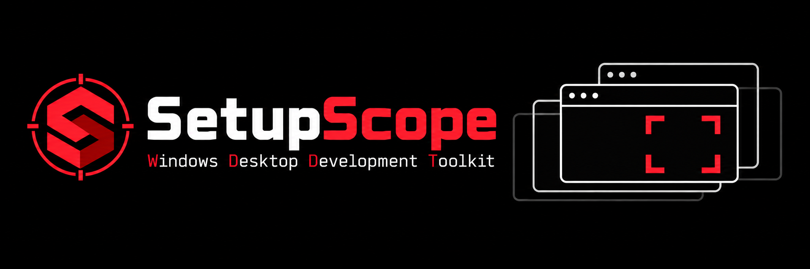

# SetupScope

A compact Windows desktop developer toolkit. Five purpose-built tools help you inspect projects, troubleshoot build failures, review development environments and understand local processes. Developer dependencies, diagnostic export and recovery are integrated into those workflows.

**1.0.0.0 local release package · Windows 11 x64 · MIT · No account · No telemetry**

[Download SetupScope 1.0.0.0](https://github.com/SeanShaffer88/SetupScope/releases/tag/v1.0.0.0) · [Validation and known limits](docs/RELEASE-VALIDATION.md)

## Start here

Unpack the portable folder into a writable local location and run **SetupScope.exe**. The application itself needs Windows, not a separate .NET runtime, Python installation or Visual C++ Redistributable. The MSVC C runtime is statically linked. A compatible Windows graphics driver is required. Developer toolchain installers are optional downloads selected inside the application; their payloads are not included by default.

The unsigned local build can trigger Windows reputation warnings. There is no certificate/signing claim. Administrator access is not needed to open the toolkit or perform ordinary passive checks. Vendor installation and some system observations have their own permission requirements, explained where used.

The main Workflow Board has six cards in a 3-column × 2-row grid: the five tools and a read-only System And OS card with Windows build, architecture, CPU threads and RAM. Tool features appear as lists. It starts without maximizing. Its header reads **Windows Software Development Toolkit**, with **Settings** at the far right. Opening/focusing a tool hides the board. Each tool has a top-right **Workflow Board** button that shows the main window while leaving every tool open and its work running. Closing the last tool also restores the board. Each tool has its own independently resizable window and taskbar entry; selecting it again focuses the existing window. One GUI instance runs per Windows session. Launching another copy restores the existing board. The status bar shows Windows build, host/application architecture, CPU threads and available/total RAM.

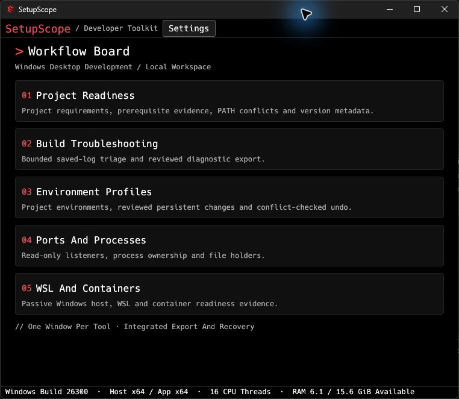


## Languages

Settings → Language offers English plus all ten existing catalogs: Spanish, German, French, Brazilian Portuguese, Italian, Russian, Simplified Chinese, Japanese, Korean and Polish. Each catalog covers 600 owned UI strings plus 58 preserved technical identifiers, including tooltips, safety guidance and statuses. Original diagnostic evidence, commands, vendor reviews/output and CLI help retain their original wording. Independent native-speaker review remains welcome. See [language coverage and limits](docs/LOCALIZATION.md). No translation service or account is required.

<details>
<summary>Settings and language previews</summary>

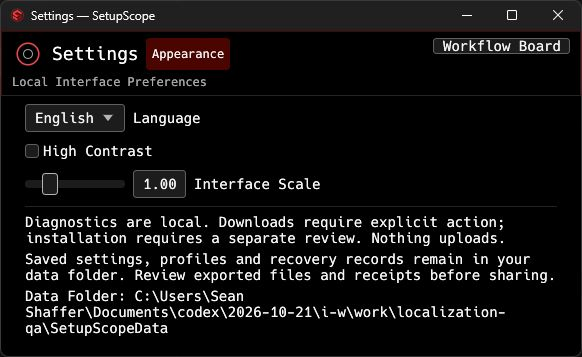

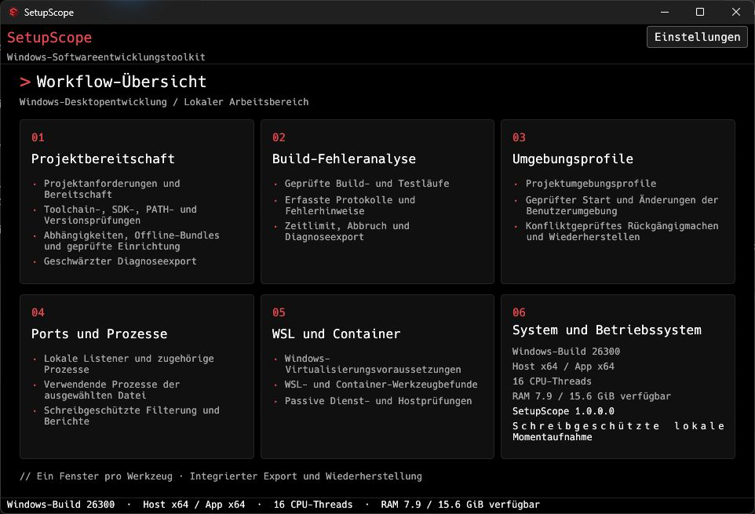

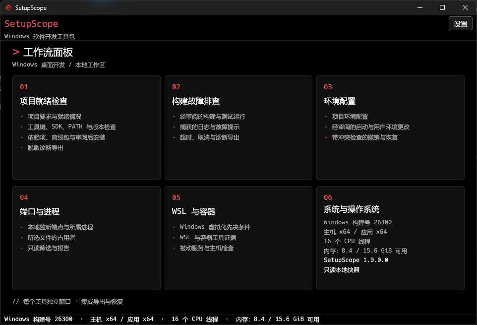

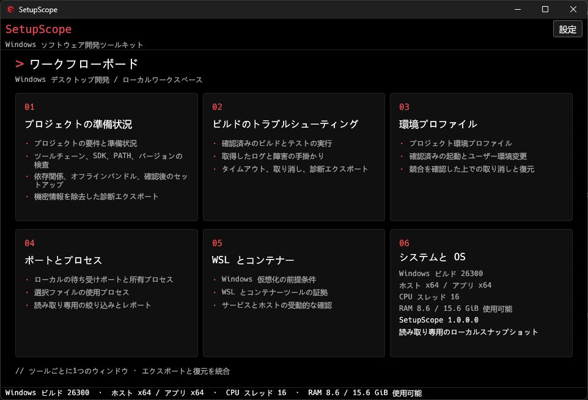

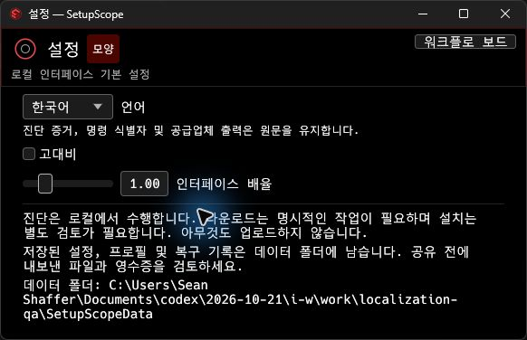

</details>

> Screenshots show local read-only observations and explicitly synthetic saved-log examples. System/tool details vary by PC. Captures precede the final terminology review; some wording has since improved.

## The five tools

| Tool | Workflow | Important boundary |
| --- | --- | --- |
| Project Readiness | Select a project, target and profile; inspect bounded requirements, prerequisites, PATH/version evidence and optional saved-log hints. Requirements, Toolchain / PATH, Export and Dependencies remain in this one window. | Presence/metadata is not proof of a successful build. Project scripts and commands never run as diagnostics. |
| Build Troubleshooting | Separately review a build/test command, capture bounded logs, inspect saved-log hints and export reviewed redacted JSON. | Execution runs project code with your account/environment and requires acknowledgment. Cancellation cannot undo side effects. Log inspection remains read-only. |
| Environment Profiles | Edit project paths/variables, preview a process environment, then separately review a child launch or persistent user-environment change. Inspect recorded recovery in the same tool. | Launch is not a sandbox. Persistent edits require review; undo refuses conflicting current values. |
| Ports And Processes | Inspect listeners and explicitly selected file owners; filter/page evidence. | No connections, process termination, unlocking, handle closure or firewall edits. Access restrictions and races can make observations incomplete. |
| WSL And Containers | Explicit passive inspection of host, virtualization, CLI-file and service metadata. | No distribution/container/engine/service starts or daemon connections. Installed metadata does not prove runtime health. |

Each window has a custom instrument mark, workflow cues, compact controls and an operation-boundary badge. Readiness uses a project dossier; troubleshooting a log waveform; environments a branching profile; ports an endpoint map; containers a host stack. Dependencies uses its own download/package workspace and Review First badge.

<details><summary>Project Readiness</summary>

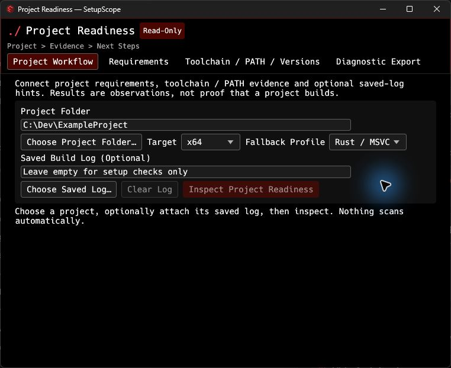

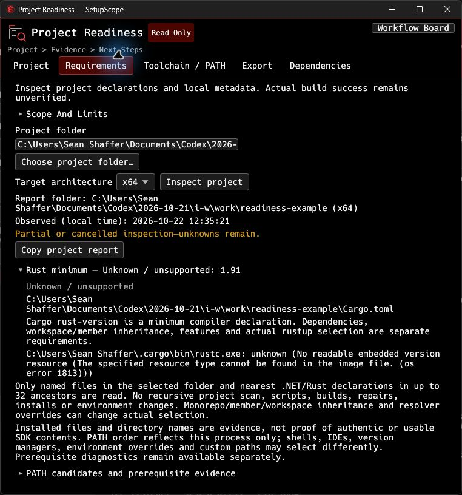

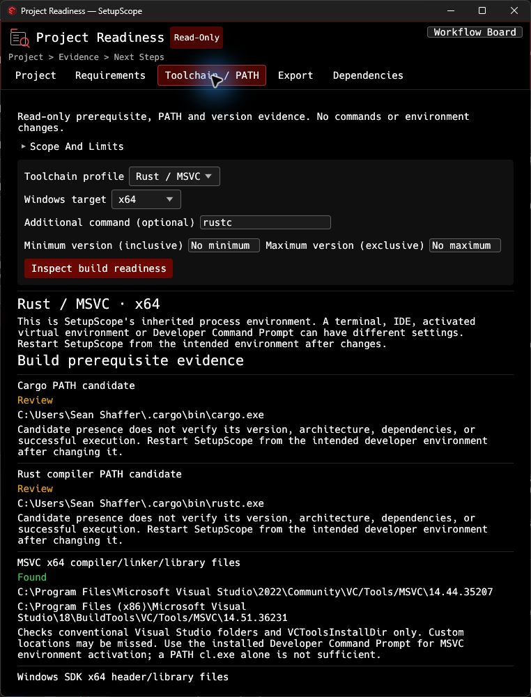

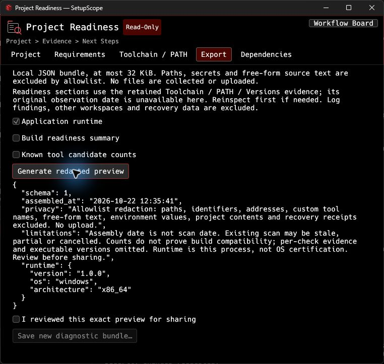

</details>
<details><summary>Build Troubleshooting</summary>

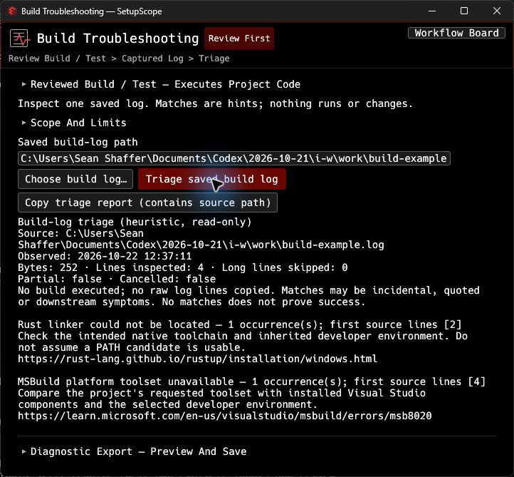

</details>
<details><summary>Environment Profiles And Recovery</summary>

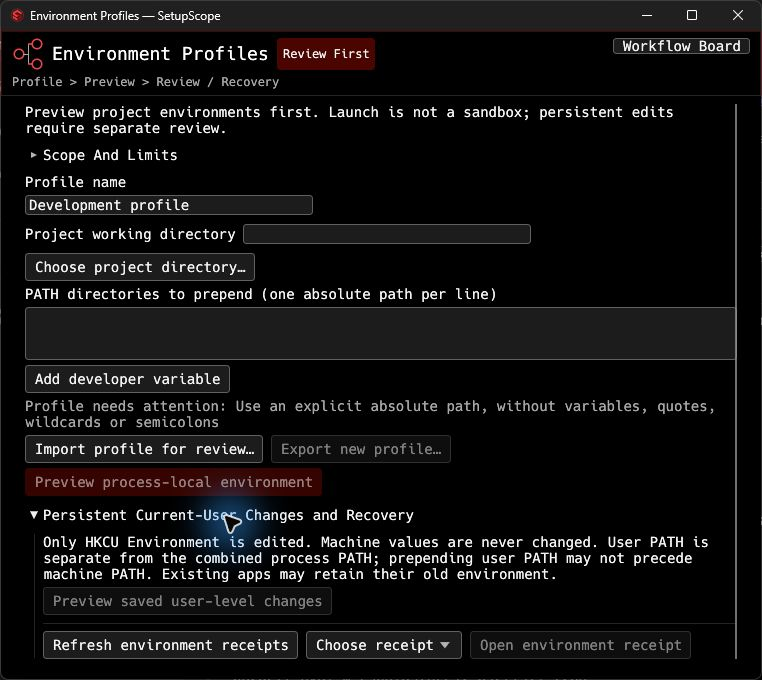

</details>
<details><summary>Ports And Processes</summary>

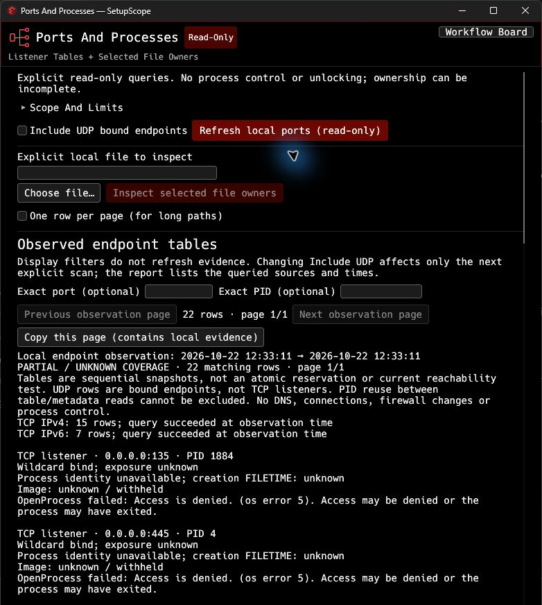

</details>
<details><summary>WSL And Containers</summary>

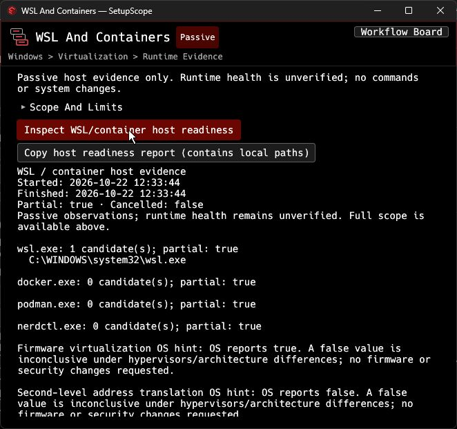

</details>

## Developer Dependencies

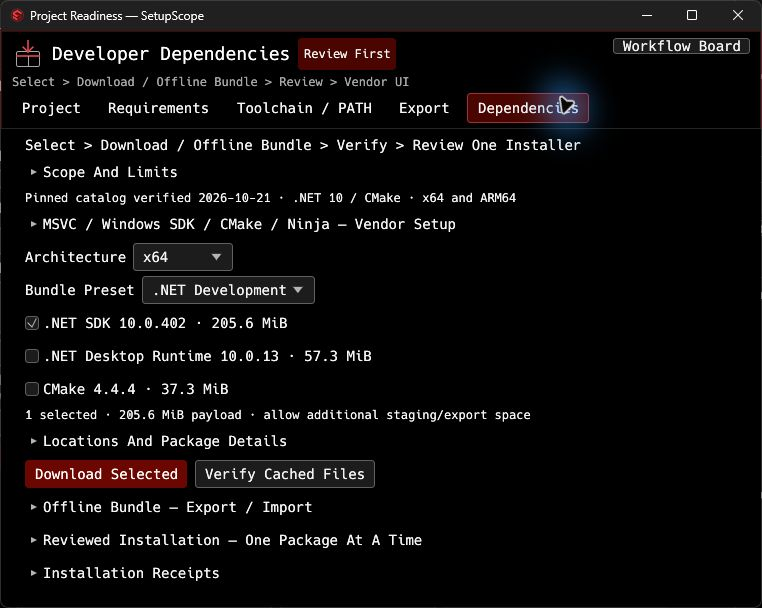

Open **Project Readiness → Dependencies**. Choose architecture and a preset, or individual packages. The initial pinned catalog provides .NET SDK 10.0.402, .NET Desktop Runtime 10.0.13 and CMake 4.4.4 for x64 and ARM64. .NET Development selects the SDK without a redundant runtime; CMake configures builds and does not include a compiler/Windows SDK.

1. Review package details: exact version, payload size, official source URL, expected publisher, pinned hash, licensing link and exclusions. Optionally choose a short local library folder.
2. **Download Selected** explicitly contacts official vendor hosts over OS-validated HTTPS. Size and SHA-256/SHA-512 are checked before atomic publication; Authenticode and signing-certificate organization are checked afterward. Existing cache files are preserved and reverified.
3. **Verify Cached Files** performs the same local checks without downloading or installing. Signature validation uses cached Windows trust and does not query online revocation status.
4. **Offline Bundle** exports selected installers to a new directory after licensing review. A bounded manifest is written last. Import accepts only the compiled catalog's IDs and revision, then rechecks every installer. External commands, URLs/digests and arbitrary archive extraction are rejected.
5. Select exactly one cached package and **Prepare Exact Install Review**. Inspect the held file, hash, publisher, fixed command, elevation request and recovery limits. Acknowledge that exact review before **Launch Reviewed Vendor Installer** becomes available. Changing inputs clears review. Hash/signature are rechecked and a durable receipt is required before launch.

Vendor installers stay interactive. No silent switches, arbitrary install commands, automatic repair or automatic rollback are supported. Vendors can change PATH, registry, shared runtimes and Program Files, remove earlier vendor versions and require a reboot. Use their UI to configure/cancel installation. Closing SetupScope cannot cancel or undo a vendor installer. Recover through the vendor uninstaller/Installed Apps, considering other projects that use shared components. Exit success is not proof of build readiness; reinspect separately.

Pinned offline bundles exclude workloads, project packages, NuGet restores, MSVC, Windows SDK and transitive prerequisites. **MSVC / Windows SDK / CMake / Ninja — Vendor Setup** handles native components and vendor-managed offline layouts separately, using an officially downloaded local Microsoft bootstrapper, observed hash, publisher checks and separate launch review. It does not promise pinned or complete air-gapped native toolchains. The full-installer catalog is fixed. Details: [Developer Dependencies](docs/DEPENDENCY-MANAGER.md).

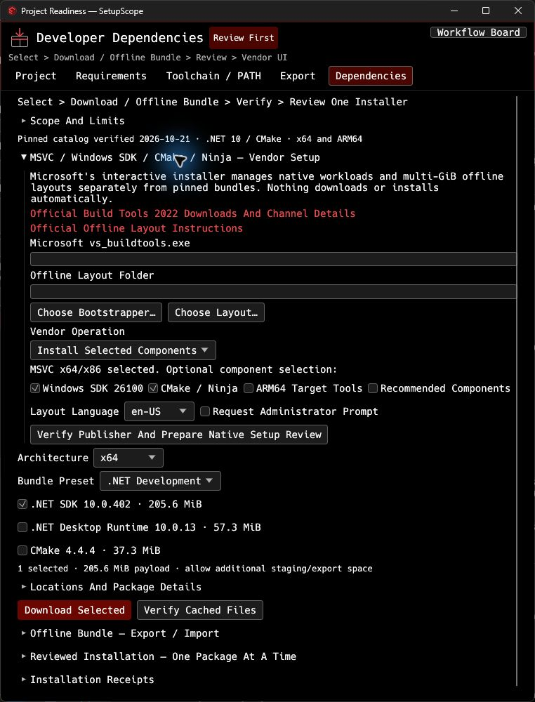

## Reviewed Build And Test

Inside Build Troubleshooting, expand **Reviewed Build / Test**. Choose a project folder, trusted `.exe`, literal arguments, log folder and timeout. Presets cover Rust, .NET, CMake/CTest and MSBuild. Prepare and acknowledge the review before running. Project inspection never executes commands. Execution inherits your account/environment/network access and is not a sandbox.

Logs stay below 2 MiB, with explicit truncation status. Cancellation/timeout stops the contained tree; remaining descendants stop on root exit. Files, downloads and remote effects cannot be automatically undone. Select the captured log for separate triage. [Workflow and limits](docs/BUILD-AND-TEST.md).

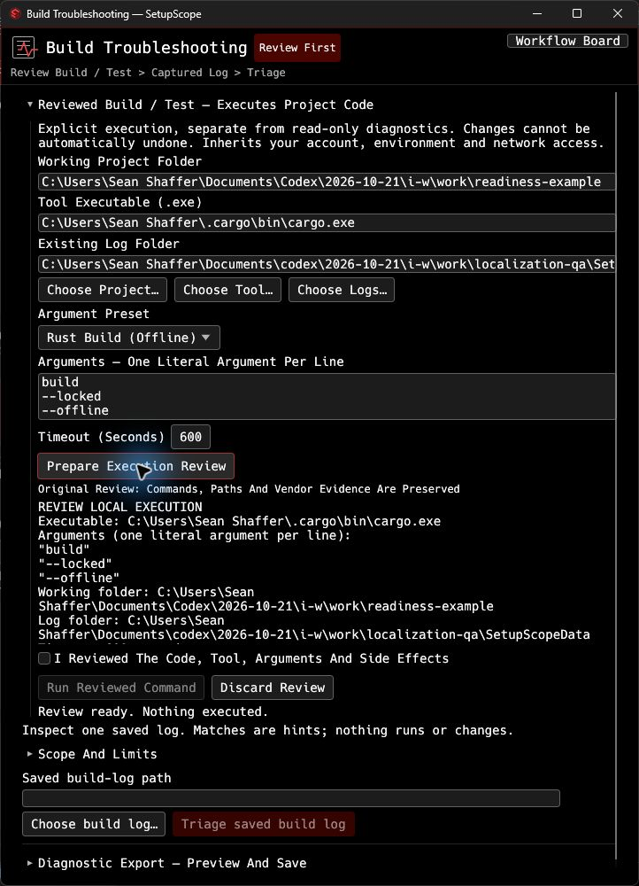

## Project workflow

Start with Project Readiness and choose an absolute local project folder. Attach a saved log only if useful. Inspect explicitly, then review partial, unknown or stale evidence before following a next step. Toolchain / PATH includes numeric version metadata comparisons; unsupported constraints remain unknown.

For build failures, choose the saved log in Build Troubleshooting. Use Environment Profiles if the intended project environment differs from the current process; preview first. Follow file-owner or host-prerequisite questions into their dedicated tools. Before sharing diagnostics, preview the exact redacted JSON and save it as a new file. Nothing uploads.

Readiness bounds recognized files to 256 KiB per manifest, 2 MiB total and up to 32 ancestors. Log analysis is bounded and reads selected files only. Inaccessible files, unsupported declarations, cancellations and filesystem races are reported; passive evidence is never promoted to a successful-build claim.

## Configuration and accessibility

Settings offers High Contrast and Interface Scale. Window heights fit content on opening and when sections/results change, with normal padding and a monitor-height cap; longer content scrolls. Manual resizing remains available until content changes. Widths are tailored to each tool and controls wrap. Review gates and uncertainty remain explicit. Tab/Shift+Tab navigate controls, Enter/Space activate focused actions and Escape closes transient menus/dialogs. Accessible names, roles, states and tooltips supplement visible instructions. Actual screen-reader and broad DPI acceptance remain environment-limited; see [release checks](docs/RELEASE-VALIDATION.md).

## Privacy, storage and recovery

Core diagnostics are local. Dependency downloads and explicit vendor/source links are the only user-initiated network workflows in the current interface; vendors may have their own behavior. No account, tracking, diagnostic upload, credential collection or remote service is required.

With the portable marker beside the executable, saved settings, profiles, logs and receipts live in **SetupScopeData** there. Without it, data normally lives in `%LOCALAPPDATA%\SetupScope`. Preserve saved data when replacing the executable. Library Roots can be chosen separately for dependency caches and installation receipts. Reports/receipts can contain local paths and are not encrypted.

Environment changes retain reviewed receipts and conflict-checked undo. Diagnostic export uses an allowlist, excludes raw paths, environment values, secrets and source text, requires exact-preview acknowledgment, and refuses overwrite. Recovery metadata is not a system backup. Dependency installations use vendor recovery, with the limits described above.

To remove the portable application, close its windows and remove its program folder; retain any saved data or offline bundles you need first. SetupScope does not register a service, startup task, shell extension or driver in this release. Removing the toolkit does not uninstall developer dependencies you installed through vendor setup.

## Troubleshooting

- Cannot open a window: verify Windows 11 x64 and graphics drivers; record the exact startup error. No graphics/clean-machine compatibility beyond the recorded checks is implied.
- Existing instance: selecting an open tool focuses it. A second GUI launch exits after requesting focus for the existing board.
- Missing/corrupt cached installer: inspection blocks use. Preserve the suspect file for investigation or choose a clean library folder; existing files are never silently repaired/replaced.
- Signature/chain unavailable offline: cached Windows trust may be insufficient. Do not bypass the check; validate Windows trust/network policy separately and retry.
- Incomplete bundle: a completed export requires its final manifest. Inspect the folder and select a new destination; no partial directory is declared complete.
- Prepared/pending receipt: installer launch/completion is not confirmed. Check vendor state before retrying. A final exit code still does not establish project readiness.
- Denied/partial observations: some system/process evidence requires permissions or disappears during inspection. Review the partial result rather than assuming an absence.

## Build, tests and packaging

Development uses Rust 1.91+, MSVC C++ build tools and a Windows SDK. Those build tools are not requirements for running the packaged app. Keep Cargo.lock and the documented vendored accessibility patch.

```powershell
cargo build --example lockholder --locked
cargo test --locked
cargo clippy --all-targets --locked
cargo build --release --locked
.\scripts\package-local.ps1
```

Cargo uses semantic version **1.0.0**; Windows file/product version and `--version` use **1.0.0.0**. Launch without arguments for the board. Use **SetupScope-cli.exe** for diagnostics, toolchain/PATH/version checks, build-log triage, ports/file owners, passive containers, dependency download/offline bundles, environment previews and reviewed execution/install/apply/undo. Run `--help` for syntax; retired maintenance commands stay rejected. See [Developer CLI](docs/CLI.md) for examples, JSON output and confirmation rules.

The package includes checksums, upstream license notices and a CycloneDX Cargo dependency inventory. The inventory covers the resolved Windows x64 graph (including build/dev dependencies), not binary reachability, vulnerabilities or certification of third-party software. Optional developer installers are not redistributed by default. [Packaging and notices](docs/RELEASE-VALIDATION.md) records the actual checks and environment limits.

## Support, security and license

Report a minimal reproduction through the [project issue tracker](https://github.com/SeanShaffer88/SetupScope/issues). Redact secrets and private paths. For sensitive findings, use GitHub's private vulnerability reporting if enabled; otherwise request a private contact channel before sharing exploit details or personal data.

SetupScope code is MIT licensed; see [LICENSE](LICENSE). Bundled components, fonts and notices retain their upstream terms. The desktop child-window accessibility change is documented in [GUI dependency patch](docs/GUI-DEPENDENCY-PATCH.md). Brand artwork is in [Brand Assets](docs/BRANDING.md).

## Clean Windows verification

The portable folder includes `Test-CleanMachine.ps1`: integrity checks and isolated process-environment smoke tests without SDKs, installs or network access. See [clean-machine instructions and limits](docs/CLEAN-MACHINE.md). Independent agent review checked all 6,000 owned translations and corrected 80 wording issues; [review evidence](docs/LOCALIZATION-REVIEW.json). VM checks are intentionally skipped for this local package. Human native-speaker certification remains unverified.
